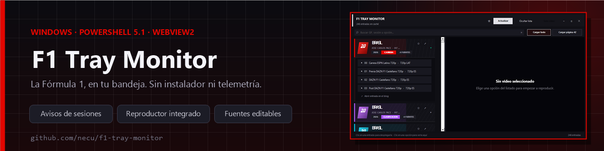
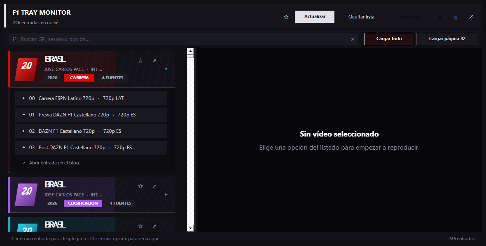
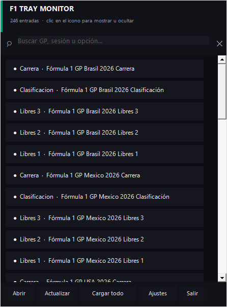
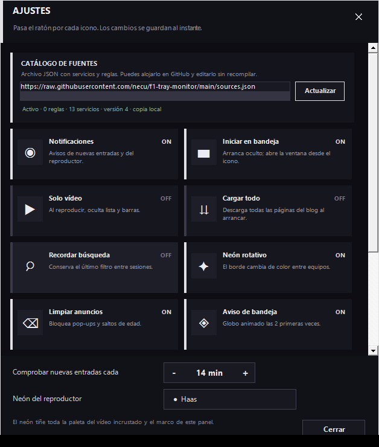

# F1 Tray Monitor



**A Windows tray app that notifies you about new Formula 1 downloads and plays them without ads.**


[](LICENSE)

[Versión en español](README.md)

**Project page:** [`docs/index.html`](docs/index.html) (ready for GitHub Pages) ·
**Roadmap:** [`docs/ROADMAP.md`](docs/ROADMAP.md)

---

## What it does

F1 Tray Monitor lives in the system tray, checks the download blog every few minutes and
shows a native Windows notification as soon as a new entry appears. From its window you can
search, expand and play any session in a clean player with no popups or ad overlays.

Video plays **inside the app window**, to the right of the entry list, through WebView2 (the
Microsoft Edge engine already included with Windows). You can switch sources without leaving,
hide the list or go full video-only in a borderless, resizable window. Opera is optional:
with `playerMode: "external"` the player opens in an external browser.



## Features

- **System tray**: left-click to show or hide the window; right-click opens a custom panel
  with a search box, expandable entries and quick actions.
- **Automatic checks** every N minutes, with new-entry detection.
- **Smart search**: besides ignoring accents, it understands F1 synonyms (countries,
  circuits, sessions, languages and platforms), prefixes and small typos. `interlagos`
  finds the Brazilian GP and `clasi` the qualifying session.
- **Accordion cards**: only one entry stays open; opening another closes the previous one.
- **Blog pagination**: a *Load page N* button appends older entries to the list.
- **Load all**: chains every available page in one click, in parallel batches with visible
  progress; the button turns into *Stop* so you can cancel whenever you want.
- **Instant, resizable window**: the window and player are prewarmed hidden at startup, the
  list is cached (searching or filtering no longer rebuilds the cards) and the splitter keeps
  its ratio without hard minimums; dragging it to the edge hides the list.
- **Favourites**: a star on each card marks a GP or session. The *favourites only* filter is
  global and shared by the main window and the tray panel.
- **Search history**: the last 8 queries show up when the search box gets focus, in a floating
  panel that never steals focus, with per-item and full deletion.
- **Maintenance in Settings**: `monitor.log` viewer, export and import of all settings as a
  portable JSON file, and GitHub Releases version checks.
- **Catalogue priority and expiry**: rules are sorted by `priority` and rules whose `expires`
  date has passed are ignored without deleting anything.
- **Embedded player**: video opens to the right of the list, with a smart source selector
  grouped by platform, quality/language badges and keyboard navigation, plus reload and a
  link to the original source.
- **Remote source catalogue**: an editable `sources.json` (for example on GitHub) lets you
  publish curated players for each GP, session or entry without scraping again.
- **Team neon**: the player's animated border uses the colours of memorable F1 teams
  (Ferrari, McLaren, Mercedes, Red Bull, Williams, Lotus...). It can stay on one team or
  rotate every 12 seconds.
- **Icon settings**: a minimalist panel with switches and explanatory tooltips; everything
  is saved instantly to `config.json`.
- **Tray hint**: an animated balloon the first two times explaining how to open the window
  and its options; it stops once you use right-click.
- **Hideable list and video-only mode**: hide the list or switch to a borderless window with
  just the video; the player's *Show list* button brings it back.
- **Window layers**: normal, always on top or desktop background, without restarting.
- **Official icon**: multiresolution `f1.ico` (16–256 px) grouped in the taskbar with its own
  AppUserModelID.
- **Strict ad blocking**: the same rules and cleaner run inside WebView2 and in the MV3 Opera
  extension: no popups, dialogs, odd navigations or overlays.
- **No telemetry**: no analytics, no accounts, no project servers.
- **No installer**: PowerShell scripts plus a `.cmd` launcher. No admin rights needed.

## Requirements

| Requirement | Details |
|---|---|
| OS | Windows 10 or 11 |
| PowerShell | 5.1 (included with Windows) |
| Player | WebView2 Runtime, included with Microsoft Edge on Windows 10/11. Falls back to external mode if missing. |
| Browser | Optional: Opera for external mode. Falls back to the default browser. |
| Network | Needed to read the blog and play content. |

No Python, Node or extra .NET runtime is required.

## Quick start

1. Download the project (**Code → Download ZIP**) or clone it:

   ```powershell
   git clone https://github.com/necu/f1-tray-monitor.git
   ```

2. Extract it somewhere stable, for example `C:\Users\necu\F1TrayMonitor`.

3. Double-click **`F1 Monitor.cmd`**.

   The monitor starts, shows its window and leaves the icon in the tray. On first run it
   caches the latest 6 entries and shows a balloon notification. If you enable *Start in
   tray* in Settings, it will start hidden and a single click on the icon opens it.

4. Optional: start it automatically at sign-in.

   ```text
   setup.cmd
   ```

   This creates a shortcut in your user *Startup* folder. Run `uninstall.cmd` to remove it.

> **Note:** Windows SmartScreen may warn about downloaded `.cmd` files. That is expected.
> Everything is plain text, so you can review the code before running it.

## Usage

| Action | How |
|---|---|
| Show or hide the window | Left-click the tray icon (toggles) |
| Quick panel | Right-click the tray icon: search, entries and actions |
| Search | Type in the top box; it understands synonyms and typos |
| Expand an entry | Click the card (any other open card closes) |
| Play | Click an option inside the card: video appears on the right |
| Switch source | Source button in the player bar: panel grouped by service |
| Change layer | Layer button (`L`) or tray panel: normal → always on top → desktop |
| Hide the list | *Hide list* button in the header |
| Video-only mode | *Video only* button; *Show list* in the video bar to return |
| Open the blog entry | *Open blog entry* link |
| Load older entries | *Load page N* button |
| Load every entry | *Load all* button (press again to *Stop*) |
| Settings | Right-click the tray icon → *Settings* |
| Refresh now | *Refresh* button or the tray panel |

In the player, move the pointer to the top edge to reveal the control bar:

- **Source selector**: a button showing the active service opens a panel grouped by platform.
  Each option shows quality, language and a star when it is the primary source; it works with
  mouse or arrows, Home/End, Enter and `Esc`.
- **Reload** (`R`): reloads the video.
- **Open in browser**: opens the original source in a normal tab.
- **Fullscreen** (`F`): toggles fullscreen.
- **Layer** (`L`): cycles normal, always on top and desktop background.
- `Esc`: hides the bar.
- In **video-only mode** the bar also includes drag, *Show list*, minimize, maximize and close.

## Tray panel and settings

Right-clicking opens a panel styled like the rest of the app instead of the classic Windows
menu. It includes its own search box (with the same synonyms and typo tolerance), expandable
entries to pick a source, and shortcuts to *Open*, *Refresh*, *Load all*, *Settings* and
*Exit*.



A left-click toggles the window between visible and hidden without closing the app or
stopping the checks.

### Icon settings

In *Settings* every option is a tile with an icon; hovering shows a tooltip explaining what it
does and when it applies. Changes are saved instantly to `config.json`:

| Option | What it does |
|---|---|
| Notifications | Balloon alerts when new entries are found. |
| Start in tray | Starts without opening the window. |
| Video only | Hides the list and bars when playing. |
| Load all | Chains every blog page at startup. |
| Remember search | Restores the last filter between sessions. |
| Rotating neon | Switches team colour every 12 seconds. |
| Clean ads | Cleaner and age gate (applied on restart). |
| Tray hint | Animated balloon the first two times; right-click cancels it. |
| Source catalogue | Combines the blog with options published in `sources.json`. |

The same screen lets you change the check interval with a `−` / `+` stepper, pick the neon
team with one click and edit the catalogue URL with its *Refresh* button.



### Team neon

The player's animated border uses the characteristic colours of memorable F1 teams: Ferrari,
McLaren, Mercedes, Red Bull, Williams, Alpine, Aston Martin, Haas, Sauber, Lotus, Brawn GP and
Renault. The chosen colour is applied instantly to the embedded video and to the settings
frame; with *Rotating neon* it changes on its own.

## The player

### Embedded mode (default)

With `playerMode: "embedded"` video plays inside the app through **WebView2**, the Microsoft
Edge engine already included with Windows 10/11:

- `player.html` is served from a local virtual host (`https://f1player.local/player.html`).
- The monitor sends sources through `window.F1Player.load()` without reloading the page.
- The SDK DLLs live in [`lib/webview2/`](lib/webview2) and load only when the window opens.
  The WebView2 runtime itself is updated with Edge.
- If WebView2 is unavailable, the app logs it in `monitor.log` and uses external mode.

The window is borderless: drag it by the header, resize it from the 6 px frame and maximize
it without covering the taskbar. In video-only mode the header and list disappear; the video
bar keeps the controls.


### External mode (optional)

With `playerMode: "external"` the player opens in **Opera** when installed
(`playerBrowser: "auto"`), using a dedicated profile at
`%LOCALAPPDATA%\F1TrayMonitor\PlayerProfile` and the local
[`opera-extension/`](opera-extension). Without Opera it uses the default browser.

### Cleaning

Both modes share the same rules and cleaner:

- Overrides `window.open`, `alert`, `confirm` and `prompt`.
- Blocks requests to ad domains from `rules.json`.
- Hides ad containers and fixed fullscreen overlays.
- Automatically accepts age gates shown by players.
- Respects legitimate links marked with `data-f1-allow` (the *Open in browser* button).

In external mode you can disable the extension with `"cleanPlayer": false`. To use your usual
browser, set `"playerBrowser": "default"`.

> No copy of Opera and no user profile is distributed with this project.

## Source catalogue (sources.json)

The catalogue lets you **add playback options without scraping again**: publish a static JSON
file (for example on GitHub) and the app downloads, caches and merges it with the blog
options. It is useful for a curated source for a specific GP, another language track or an
alternative player that is missing from the original entry.

Defaults:

- Local file shipped with the app: `sources.json`.
- Downloaded copy: `sources.cache.json` (written atomically).
- Default URL: `https://raw.githubusercontent.com/necu/f1-tray-monitor/main/sources.json`.
- Automatic refresh: every 6 hours (`sourcesRefreshHours`). The *Refresh* button in Settings
  forces an immediate download.

### Schema

```json
{
  "version": 3,
  "services": {
    "dazn":  { "label": "DAZN",  "short": "DAZN", "color": "#00E0B8" },
    "espn":  { "label": "ESPN",  "short": "ESPN", "color": "#E10600" },
    "f1tv":  { "label": "F1 TV", "short": "F1TV", "color": "#FF2D55" }
  },
  "rules": [
    {
      "enabled": true,
      "match": { "year": 2026, "gp": "brasil", "session": "Carrera" },
      "options": [
        {
          "name": "DAZN F1 · Spanish",
          "url": "https://example.com/embed/abc123",
          "service": "dazn",
          "quality": "1080p",
          "lang": "ES",
          "primary": true
        }
      ]
    }
  ]
}
```

| Field | Description |
|---|---|
| `services` | Platform catalogue: `label` (visible name), `short` (abbreviation) and `color` (hex for the dot and badges). |
| `rules[].enabled` | When `false` the rule is skipped. Missing means enabled. |
| `rules[].match.id` | Exact entry identifier (`tab-538771`). |
| `rules[].match.year` | GP year (`2026`). |
| `rules[].match.gp` | GP or alias: `brasil`, `interlagos`, `mexico`, `cdmx`… |
| `rules[].match.session` | Normalised session: `carrera`, `clasificacion`, `sprint`, `sprintshootout`, `libres1`, `libres2`, `libres3`, `previa` or `post`. |
| `rules[].match.type` | Blog entry type (case-insensitive substring). |
| `rules[].match.titleContains` | Free text that must appear in the title. |
| Empty `rules[].match` | The rule applies to every entry. |

Every condition in `match` must hold. Rules are evaluated top to bottom and catalogue options
are placed **before** blog options; when two options share a URL, only the first (curated) one
is shown.

Each option accepts `name`, `url`, `service` (a key from `services`), `quality` (`4K`,
`1080p`, `720p`…), `lang` (`ES`, `LAT`, `EN`, `VOSE`…) and `primary` (star and preferred
source).

### Adding a source with validation

```powershell
.\tools\add-source.ps1 -Url "https://example.com/embed/abc" -Name "DAZN F1 · Spanish" `
    -Service dazn -Quality 1080p -Lang ES -Year 2026 -Gp brasil -Session Carrera -Priority 30
```

It validates the URL and service, rejects duplicates, keeps `sources.json.bak` and runs
`check_sources.ps1` before writing. `-DryRun` prints the resulting rule and
`-Expires 2026-12-01` lets it expire. The `fuentes-nuevas` skill guides the agent through
finding and verifying new links.

### Editing the catalogue on GitHub

1. Edit `sources.json` in your repository (or a Gist) and validate the JSON.
2. In Settings, paste the **raw** URL of the file into the catalogue field.
3. Press *Refresh*. If the JSON is invalid or the download fails, the last good copy is kept
   and the panel status warns you.

> The catalogue contains only URLs, names and metadata: the app does not host or redistribute
> video.

## Configuration

Settings live in [`config.json`](config.json):

```json
{
  "intervalMinutes": 5,
  "days": ["Friday", "Saturday", "Sunday"],
  "playerMode": "embedded",
  "playerBrowser": "auto",
  "cleanPlayer": true,
  "maxPostsOnFirstRun": 6,
  "notifications": true,
  "startMinimized": false,
  "openVideoOnly": false,
  "autoLoadAll": false,
  "rememberSearch": true,
  "neonTeam": "ferrari",
  "neonCycle": false,
  "sourcesEnabled": true,
  "sourcesUrl": "https://raw.githubusercontent.com/necu/f1-tray-monitor/main/sources.json",
  "sourcesRefreshHours": 6,
  "trayHint": true,
  "updateCheck": true
}
```

| Key | Type | Default | Description |
|---|---|---|---|
| `intervalMinutes` | integer | `5` | Minutes between checks. |
| `days` | list | Friday, Saturday, Sunday | Days when scraping runs (`Monday`…`Sunday`). Empty = weekend only. |
| `playerMode` | string | `embedded` | `embedded` plays inside the app with WebView2; `external` opens the player in a browser. |
| `playerBrowser` | string | `auto` | External mode only: `auto`/`opera` use Opera when found; `default` uses the default browser. |
| `cleanPlayer` | boolean | `true` | Loads the cleaning extension in the player profile. |
| `maxPostsOnFirstRun` | integer | `6` | Entries collected the first time there is no cache. |
| `notifications` | boolean | `true` | Shows balloon alerts in the tray. |
| `startMinimized` | boolean | `false` | Starts hidden in the tray. |
| `openVideoOnly` | boolean | `false` | Switches straight to video-only mode when playing. |
| `autoLoadAll` | boolean | `false` | Chains every blog page after the first scrape. |
| `rememberSearch` | boolean | `true` | Saves and restores the last search text. |
| `neonTeam` | string | `ferrari` | Neon team: `ferrari`, `mclaren`, `mercedes`, `redbull`, `williams`, `alpine`, `aston`, `haas`, `sauber`, `lotus`, `brawn` or `renault`. |
| `neonCycle` | boolean | `false` | Rotates the neon between teams every 12 seconds. |
| `sourcesEnabled` | boolean | `true` | Merges the blog with options from the remote catalogue. |
| `sourcesUrl` | string | GitHub URL | Address of the `sources.json` to download. |
| `sourcesRefreshHours` | integer | `6` | Hours between automatic catalogue downloads (1–168). |
| `trayHint` | boolean | `true` | Shows the animated tray hint the first two times. |
| `updateCheck` | boolean | `true` | Looks for new versions on GitHub at startup (at most once every 24 h) and from Settings. |

Force scraping on any day with:

```powershell
powershell -ExecutionPolicy Bypass -File monitor.ps1 -ScrapeAllDays
```

Runtime files are generated automatically and are not versioned:

- `f1_posts.json`: cached entries and playback options.
- `f1_state.json`: next page, last search filter, favourites, search history, tray-hint
  counter, last catalogue download time and the last version-check result.
- `f1_loadall_progress.json`: *Load all* progress while it runs.
- `sources.cache.json`: local copy of the remote catalogue (written atomically).
- `monitor.log`: rotating log (recycled above 1 MB).

## How it works

1. **`f1_scraper.ps1`** resolves the blog domain through **DNS-over-HTTPS**
   (Cloudflare `1.1.1.1`), which avoids DNS blocking by some ISPs. It then reads the
   category page, extracts each entry and its playback options, and stores everything
   sorted from newest to oldest.
2. **`monitor.ps1`** owns the tray icon, runs the scraper in the background, compares
   against known IDs, raises notifications and builds the WinForms UI.
3. **`player.html`** is the player UI. In embedded mode it is served from a local virtual
   host and the monitor sends sources through `window.F1Player.load()`; in external mode
   the selected data is injected into the HTML directly.
4. **Pagination** runs the scraper with `-Page N -AppendPage`, appending only entries that
   were not cached yet without firing notifications.
5. **`sources.json`** is downloaded in the background and its rules are merged with the blog
   options in `Get-PlayOptions`: catalogue entries come first and duplicate URLs are dropped.
6. **Load all** uses the scraper's batch mode: several pages and entry pages in parallel,
   progress in `f1_loadall_progress.json` and a single atomic write at the end.

## Project layout

```text
f1-tray-monitor/
├─ F1 Monitor.cmd          Portable launcher
├─ setup.cmd               Start at sign-in
├─ uninstall.cmd           Remove the startup shortcut
├─ monitor.ps1             Tray process, UI and notifications
├─ f1_scraper.ps1          DNS-over-HTTPS scraper with batch mode
├─ player.html             Player UI ("pit wall" bar)
├─ sources.json            Editable service and rule catalogue
├─ sources.schema.json     Catalogue JSON schema (draft-07)
├─ sources.example.json    Minimal example catalogue, checked in CI
├─ check_sources.ps1       Structural catalogue validation (local and CI)
├─ package.ps1             Reproducible packaging + SHA256SUMS
├─ tools/add-source.ps1    Guided, validated source intake
├─ tools/stream-part.ps1   Local HTTP range server (watch while downloading)
├─ f1.ico                  Multiresolution icon (16-256 px)
├─ config.json             User settings
├─ releases/               ZIP package for each version
├─ lib/webview2/           WebView2 .NET SDK and Microsoft licenses (MIT)
├─ opera-extension/        MV3 cleaning extension (manifest, JS, CSS, rules)
├─ install-autostart.ps1   Startup shortcut logic
├─ uninstall-autostart.ps1
├─ start-monitor.vbs       Hidden launcher (no console)
├─ check_monitor.ps1       Helper to detect a running instance
└─ docs/                   Screenshots, project page and roadmap
```

## Development and testing

The monitor ships with a self-test mode that opens the window, interacts and closes itself:

```powershell
powershell -ExecutionPolicy Bypass -File monitor.ps1 -SelfTest
powershell -ExecutionPolicy Bypass -File monitor.ps1 -SelfTest -SelfTestAction search
powershell -ExecutionPolicy Bypass -File monitor.ps1 -SelfTest -SelfTestAction accordion
powershell -ExecutionPolicy Bypass -File monitor.ps1 -SelfTest -SelfTestAction page
powershell -ExecutionPolicy Bypass -File monitor.ps1 -SelfTest -SelfTestAction video
powershell -ExecutionPolicy Bypass -File monitor.ps1 -SelfTest -SelfTestAction loadall
powershell -ExecutionPolicy Bypass -File monitor.ps1 -SelfTest -SelfTestAction ui
powershell -ExecutionPolicy Bypass -File monitor.ps1 -SelfTest -SelfTestAction catalog
powershell -ExecutionPolicy Bypass -File monitor.ps1 -SelfTest -SelfTestAction resize
```

`catalog` loads the catalogue, checks that its rules match real cached entries and exercises
favourites and history. Each variant writes its result to `monitor.log` and saves a screenshot to `%TEMP%`.

Quick checks before sending a change:

```powershell
$errs = $null
[void][System.Management.Automation.Language.Parser]::ParseFile(
    (Resolve-Path .\monitor.ps1), [ref]$null, [ref]$errs)
if ($errs) { $errs; exit 1 }

Get-Content .\config.json -Raw | ConvertFrom-Json | Out-Null
Get-Content .\sources.json -Raw | ConvertFrom-Json | Out-Null
Get-Content .\opera-extension\manifest.json -Raw | ConvertFrom-Json | Out-Null
Get-Content .\opera-extension\rules.json -Raw | ConvertFrom-Json | Out-Null

# Catalogue and reproducible package
.\check_sources.ps1
.\package.ps1 -Verify
```

Self-tests and the normal monitor share a single-instance mutex: close the monitor before
starting a self-test. Published packages live in `releases/`; the current ZIP excludes caches
and logs (`f1_posts.json`, `f1_state.json`, `monitor.log`).

GitHub Actions runs the same checks plus
[PSScriptAnalyzer](https://github.com/PowerShell/PSScriptAnalyzer) on every push and pull
request. The [`release.yml`](.github/workflows/release.yml) workflow packages and publishes
the ZIP and `SHA256SUMS` when a `v*` tag is pushed. See [CONTRIBUTING.md](CONTRIBUTING.md).

### Sharing the project

- **Page**: enable GitHub Pages with *Deploy from a branch* → `main` / `/docs`. The page is
  `docs/index.html`, with no external assets or JavaScript.
- **Release**: `git tag v1.3.0 && git push origin v1.3.0`. The workflow validates, packages
  and attaches the ZIP and its hashes to the release.
- **Catalogue**: publish `sources.json` on `main` so the default URL stops returning 404.

## Privacy and legal notice

- The project **collects no data**, ships no analytics and contacts no project servers.
- It only connects to the download blog, the source catalogue you configure and the players
  you choose to open.
- The remote catalogue is optional: disable it in Settings or point `sourcesUrl` to a local
  file. The app only downloads the JSON; it never uploads anything.
- In embedded mode video loads through WebView2 (the Edge engine); traffic goes straight to
  the chosen player, exactly as in a normal browser.
- **It does not host or distribute video**: it only indexes links published by third parties.
- Content rights belong to their owners. Use the tool responsibly and according to the law
  in your country.
- The block list is a set of common ad domains; extend or trim it in
  `opera-extension/rules.json`.

To report a security issue, see [SECURITY.md](SECURITY.md).

## Contributing

Contributions are welcome: block rules, UI improvements, translations, scraper fixes or
documentation. Read [CONTRIBUTING.md](CONTRIBUTING.md) and the
[Code of Conduct](CODE_OF_CONDUCT.md). If you are looking for ideas, there is a living list
of pending improvements in [docs/ideas.md](docs/ideas.md).

## License

[MIT](LICENSE) © 2026 F1 Tray Monitor contributors.

This project is not affiliated with Formula 1, its teams or the download blog.
