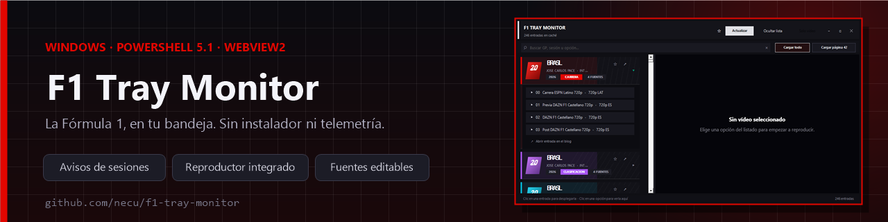
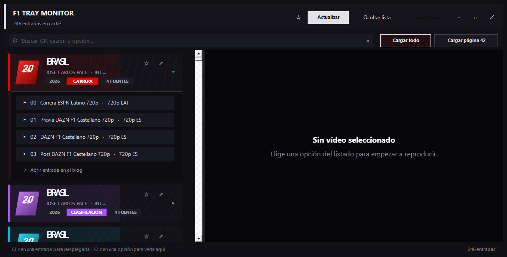
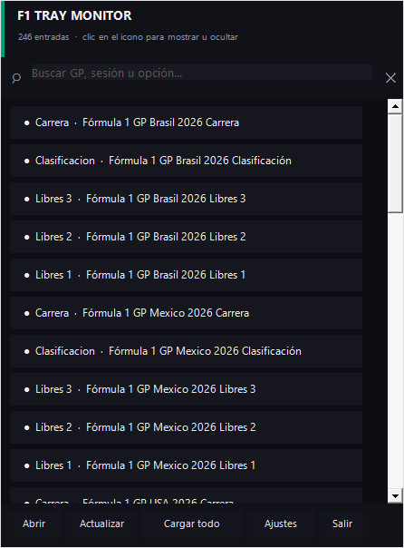
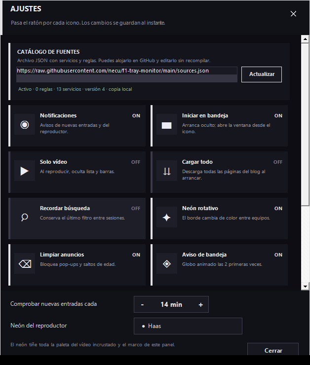
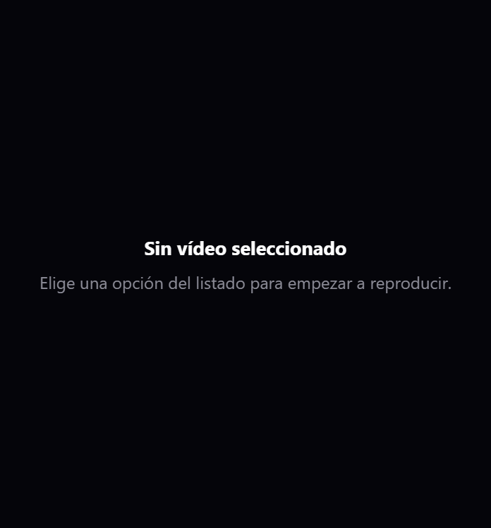

# F1 Tray Monitor



**Monitor de escritorio para Windows que avisa de las nuevas descargas de Fórmula 1 y las reproduce sin publicidad.**


[](LICENSE)

[English version](README.en.md)

**Página del proyecto:** [`docs/index.html`](docs/index.html) (lista para GitHub Pages) ·
**Hoja de ruta:** [`docs/ROADMAP.md`](docs/ROADMAP.md)

---

## Qué hace

F1 Tray Monitor vive en la bandeja del sistema, revisa el blog de descargas cada pocos
minutos y te avisa con una notificación de Windows en cuanto aparece una entrada nueva.
Desde su ventana puedes buscar, desplegar y reproducir cualquier sesión en un reproductor
limpio, sin popups ni capas publicitarias.

El vídeo se reproduce **dentro de la propia ventana**, a la derecha del listado, gracias a
WebView2 (el motor de Microsoft Edge que ya forma parte de Windows). Puedes cambiar de
fuente sin salir, ocultar el listado o quedarte solo con el vídeo en una ventana sin bordes
redimensionable. Opera es opcional: con `playerMode: "external"` el reproductor se abre en
un navegador externo.



## Características

- **Bandeja del sistema**: clic izquierdo para mostrar u ocultar la ventana; clic derecho abre
  un panel propio con buscador, entradas desplegables y acciones rápidas.
- **Vigilancia automática** cada N minutos (configurable) con detección de entradas nuevas.
- **Buscador inteligente**: además de ignorar tildes, entiende sinónimos de F1 (países,
  circuitos, sesiones, idiomas y plataformas), prefijos y pequeñas erratas. `interlagos`
  encuentra el GP de Brasil y `clasi` la clasificación.
- **Tarjetas en acordeón**: solo una entrada abierta a la vez; al abrir otra, se cierra la anterior.
- **Paginación del blog**: botón *Cargar página N* que añade entradas más antiguas al listado.
- **Cargar todo**: encadena todas las páginas disponibles con un solo clic, en lotes paralelos
  y con progreso visible; el botón pasa a *Detener* para cancelar cuando quieras.
- **Ventana instantánea y redimensionable**: la ventana y el reproductor se precalientan
  ocultos al arrancar, el listado se cachea (buscar o filtrar no reconstruye las tarjetas) y
  el divisor guarda su proporción sin mínimos rígidos; arrastrarlo al borde oculta el listado.
- **Favoritos**: una estrella en cada tarjeta marca el GP o la sesión. El filtro *solo
  favoritos* es global y se comparte entre la ventana y el panel de bandeja.
- **Historial de búsquedas**: las últimas 8 consultas aparecen al enfocar el buscador en un
  panel flotante que no roba el foco, con borrado individual y total.
- **Mantenimiento en Ajustes**: visor de `monitor.log`, exportar e importar todos los ajustes
  en un JSON portable y comprobación de versiones contra GitHub Releases.
- **Catálogo con prioridad y caducidad**: las reglas se ordenan por `priority` y las que
  llevan `expires` vencido se ignoran sin borrar nada.
- **Reproductor incrustado**: el vídeo se abre a la derecha del listado, con un selector
  inteligente de fuentes agrupado por plataforma, insignias de calidad/idioma y navegación
  por teclado, además de recarga y enlace a la fuente original.
- **Catálogo de fuentes remoto**: un `sources.json` editable (por ejemplo en GitHub) permite
  publicar reproductores curados para cada GP, sesión o entrada sin volver a escrapear.
- **Neón por equipos**: el borde animado del reproductor usa los colores de equipos históricos
  de F1 (Ferrari, McLaren, Mercedes, Red Bull, Williams, Lotus...). Puede quedarse fijo en uno
  o ir rotando cada 12 segundos.
- **Ajustes por iconos**: panel minimalista con interruptores y globos explicativos; todo se
  guarda al instante en `config.json`.
- **Aviso de bandeja**: globo animado las dos primeras veces que recuerda cómo abrir la ventana
  y las opciones; se desactiva solo si usas el clic derecho.
- **Listado ocultable y modo solo vídeo**: oculta el listado o pasa a una ventana sin bordes
  con solo el vídeo; el botón *Mostrar listado* del reproductor lo recupera.
- **Capas de ventana**: normal, siempre encima o fondo de escritorio, sin reiniciar.
- **Icono oficial**: `f1.ico` multirresolución (16–256 px) agrupado en la barra de tareas con
  su propio AppUserModelID.
- **Bloqueo estricto de publicidad**: las mismas reglas y el mismo limpiador se aplican dentro
  de WebView2 y en la extensión MV3 de Opera: sin popups, diálogos, navegaciones raras ni
  overlays.
- **Cero telemetría**: no hay analítica, ni cuentas, ni servicios propios.
- **Sin instalador**: scripts de PowerShell y un lanzador `.cmd`. Nada de administrador.

## Requisitos

| Requisito | Detalle |
|---|---|
| Sistema | Windows 10 u 11 |
| PowerShell | 5.1 (incluido en Windows) |
| Reproductor | WebView2 Runtime, incluido con Microsoft Edge en Windows 10/11. Si falta, se usa el modo externo. |
| Navegador | Opcional: Opera para el modo externo. Si no está, se usa el navegador predeterminado. |
| Conexión | Necesaria para consultar el blog y reproducir. |

No hace falta instalar Python, Node ni .NET adicional.

## Instalación rápida

1. Descarga el proyecto (botón **Code → Download ZIP**) o clónalo:

   ```powershell
   git clone https://github.com/necu/f1-tray-monitor.git
   ```

2. Extrae la carpeta en un sitio estable, por ejemplo `C:\Users\necu\F1TrayMonitor`.

3. Haz doble clic en **`F1 Monitor.cmd`**.

   El monitor arranca y muestra la ventana; el icono queda en la bandeja. La primera vez
   descarga la caché inicial (6 entradas) y muestra un aviso. Si activas *Iniciar en bandeja*
   en Ajustes, arrancará oculto y bastará un clic en el icono para abrirlo.

4. Opcional: arranque automático al iniciar sesión.

   ```text
   setup.cmd
   ```

   Crea un acceso directo en la carpeta *Inicio* de tu usuario. Para quitarlo, ejecuta
   `uninstall.cmd`.

> **Nota:** si Windows SmartScreen avisa al ejecutar los `.cmd`, es normal en scripts
> descargados. Puedes revisar el código antes de ejecutarlo; todo es texto plano.

## Uso

| Acción | Cómo |
|---|---|
| Mostrar u ocultar la ventana | Clic izquierdo en el icono de la bandeja (alterna) |
| Panel rápido | Clic derecho en el icono: buscador, entradas y acciones |
| Buscar | Escribe en el cuadro superior; entiende sinónimos y erratas |
| Desplegar una entrada | Clic en la tarjeta (se cierra la que estuviera abierta) |
| Reproducir | Clic en una opción dentro de la tarjeta: el vídeo aparece a la derecha |
| Cambiar de fuente | Botón de fuente en la barra del reproductor: panel agrupado por servicio |
| Cambiar de capa | Botón de capa (`L`) o panel de bandeja: normal → siempre encima → fondo |
| Ocultar el listado | Botón *Ocultar lista* de la cabecera |
| Modo solo vídeo | Botón *Solo vídeo*; *Mostrar listado* en la barra del vídeo para volver |
| Abrir la entrada en el blog | Enlace *Abrir entrada en el blog* |
| Cargar entradas antiguas | Botón *Cargar página N* |
| Cargar todas las entradas | Botón *Cargar todo* (vuelve a pulsar para *Detener*) |
| Ajustes | Clic derecho en el icono → *Ajustes* |
| Actualizar ya | Botón *Actualizar* o panel de la bandeja |

En el reproductor, acerca el ratón a la parte superior para mostrar la barra:

- **Selector de fuente**: botón con el servicio activo que abre un panel agrupado por
  plataforma. Cada opción muestra calidad, idioma y una estrella si es la fuente principal;
  se maneja con ratón o con flechas, Inicio/Fin, Enter y `Esc`.
- **Recargar** (`R`): vuelve a cargar el vídeo.
- **Abrir en el navegador**: abre la fuente original en una pestaña normal.
- **Pantalla completa** (`F`): alterna pantalla completa.
- **Capa** (`L`): alterna ventana normal, siempre encima y fondo de escritorio.
- `Esc`: oculta la barra.
- En **modo solo vídeo** la barra incluye además arrastrar, *Mostrar listado*, minimizar,
  maximizar y cerrar.

## Panel de bandeja y ajustes

El clic derecho abre un panel con el mismo estilo oscuro de la app, no el menú clásico de
Windows. Incluye un buscador propio (con los mismos sinónimos y tolerancia a erratas),
entradas desplegables para elegir fuente y accesos directos a *Abrir*, *Actualizar*,
*Cargar todo*, *Ajustes* y *Salir*.



El clic izquierdo alterna entre mostrar y ocultar la ventana, sin cerrar la app ni detener
las comprobaciones.

### Ajustes por iconos

En *Ajustes* cada opción es una baldosa con un icono; al pasar el ratón aparece un globo que
explica qué hace y cuándo se aplica. Los cambios se guardan al instante en `config.json`:

| Opción | Qué hace |
|---|---|
| Notificaciones | Globos de aviso al detectar entradas nuevas. |
| Iniciar en bandeja | Arranca sin abrir la ventana. |
| Solo vídeo | Al reproducir, oculta lista y barras. |
| Cargar todo | Encadena todas las páginas del blog al arrancar. |
| Recordar búsqueda | Restaura el último filtro entre sesiones. |
| Neón rotativo | Cambia de equipo cada 12 segundos. |
| Limpiar anuncios | Limpiador y puerta de edad (se aplica al reiniciar). |
| Aviso de bandeja | Globo animado las dos primeras veces; se cancela con clic derecho. |
| Catálogo de fuentes | Combina el blog con las opciones publicadas en `sources.json`. |

La misma pantalla permite ajustar el intervalo de comprobación con un contador `−` / `+`,
elegir el equipo del neón con un clic y editar la URL del catálogo con su botón *Actualizar*.



### Neón por equipos

El borde animado del reproductor usa los colores característicos de equipos memorables de F1:
Ferrari, McLaren, Mercedes, Red Bull, Williams, Alpine, Aston Martin, Haas, Sauber, Lotus,
Brawn GP y Renault. El color elegido se aplica al instante al vídeo incrustado y al marco del
panel de ajustes; con *Neón rotativo* va cambiando solo.

## El reproductor

### Modo incrustado (por defecto)

Con `playerMode: "embedded"` el vídeo se reproduce dentro de la app con **WebView2**, el
motor de Microsoft Edge que ya forma parte de Windows 10/11:

- `player.html` se sirve desde un host virtual local (`https://f1player.local/player.html`).
- El monitor envía las fuentes con `window.F1Player.load()`, sin recargar la página.
- Las DLL del SDK están en [`lib/webview2/`](lib/webview2) y se cargan solo al abrir la
  ventana. El runtime de WebView2 se actualiza con Edge.
- Si WebView2 no está disponible, la app lo registra en `monitor.log` y usa el modo externo.

La ventana no tiene bordes: se arrastra desde la cabecera, se redimensiona desde los 6 px
del marco y maximiza respetando la barra de tareas. En modo solo vídeo la cabecera y el
listado desaparecen; la barra del vídeo conserva los controles.



### Modo externo (opcional)

Con `playerMode: "external"` el reproductor se abre en **Opera** cuando está instalado
(`playerBrowser: "auto"`), usando un perfil dedicado en
`%LOCALAPPDATA%\F1TrayMonitor\PlayerProfile` y la extensión local
[`opera-extension/`](opera-extension). Si no hay Opera, usa el navegador predeterminado.

### Limpieza

Los dos modos comparten las mismas reglas y el mismo limpiador:

- Anula `window.open`, `alert`, `confirm` y `prompt`.
- Bloquea peticiones a dominios publicitarios de `rules.json`.
- Oculta contenedores publicitarios y overlays fijos a pantalla completa.
- Acepta automáticamente las puertas de edad de los reproductores.
- Respeta los enlaces legítimos marcados con `data-f1-allow` (el botón *Abrir en el navegador*).

En el modo externo puedes desactivar la extensión con `"cleanPlayer": false`. Para usar tu
navegador habitual, pon `"playerBrowser": "default"`.

> No se distribuye ninguna copia de Opera ni perfiles de usuario dentro del proyecto.

## Catálogo de fuentes (sources.json)

El catálogo permite **añadir opciones de reproducción sin volver a escrapear**: publicas un
JSON estático (por ejemplo en GitHub) y la app lo descarga, lo cachea y lo combina con las
opciones del blog. Es útil cuando quieres una fuente curada para un GP concreto, una copia en
otro idioma o un reproductor alternativo que no aparece en la entrada original.

Valores por defecto:

- Archivo local incluido con la app: `sources.json`.
- Copia descargada: `sources.cache.json` (se escribe de forma atómica).
- URL por defecto: `https://raw.githubusercontent.com/necu/f1-tray-monitor/main/sources.json`.
- Refresco automático: cada 6 horas (`sourcesRefreshHours`). El botón *Actualizar* de Ajustes
  fuerza una descarga inmediata.

### Esquema

```json
{
  "version": 3,
  "services": {
    "dazn":  { "label": "DAZN",  "short": "DAZN", "color": "#00E0B8" },
    "espn":  { "label": "ESPN",  "short": "ESPN", "color": "#E10600" },
    "f1tv":  { "label": "F1 TV", "short": "F1TV", "color": "#FF2D55" }
  },
  "rules": [
    {
      "enabled": true,
      "match": {
        "year": 2026,
        "gp": "brasil",
        "session": "Carrera"
      },
      "options": [
        {
          "name": "DAZN F1 · Castellano",
          "url": "https://ejemplo.com/embed/abc123",
          "service": "dazn",
          "quality": "1080p",
          "lang": "ES",
          "primary": true
        }
      ]
    }
  ]
}
```

| Campo | Descripción |
|---|---|
| `services` | Catálogo de plataformas: `label` (nombre visible), `short` (abreviatura) y `color` (hex para el punto y las insignias). |
| `rules[].enabled` | Si es `false`, la regla se ignora. Ausente equivale a activa. |
| `rules[].match.id` | Coincide con el identificador exacto de la entrada (`tab-538771`). |
| `rules[].match.year` | Año del GP (`2026`). |
| `rules[].match.gp` | GP o alias: `brasil`, `interlagos`, `mexico`, `cdmx`… |
| `rules[].match.session` | Sesión normalizada: `carrera`, `clasificacion`, `sprint`, `sprintshootout`, `libres1`, `libres2`, `libres3`, `previa` o `post`. |
| `rules[].match.type` | Tipo de entrada del blog (texto contenido, sin distinguir mayúsculas). |
| `rules[].match.titleContains` | Texto libre que debe aparecer en el título. |
| `rules[].match` vacío | La regla se aplica a todas las entradas. |

Todas las condiciones de `match` deben cumplirse a la vez. Las reglas se evalúan de arriba
abajo y las opciones del catálogo se colocan **antes** que las del blog; si dos opciones
comparten URL, solo se muestra la primera (la curada).

Cada opción admite `name`, `url`, `service` (clave de `services`), `quality` (`4K`, `1080p`,
`720p`…), `lang` (`ES`, `LAT`, `EN`, `VOSE`…) y `primary` (estrella y fuente preferida).

### Dar de alta una fuente con validación

```powershell
.\tools\add-source.ps1 -Url "https://ejemplo.com/embed/abc" -Name "DAZN F1 · Castellano" `
    -Service dazn -Quality 1080p -Lang ES -Year 2026 -Gp brasil -Session Carrera -Priority 30
```

Valida la URL y el servicio, evita duplicados, guarda `sources.json.bak` y ejecuta
`check_sources.ps1` antes de escribir. Con `-DryRun` solo muestra la regla resultante, y
`-Expires 2026-12-01` permite caducarla. La skill `fuentes-nuevas` guía al agente para buscar
y verificar enlaces nuevos antes de publicarlos.

### Editar el catálogo en GitHub

1. Edita `sources.json` en tu repositorio (o en un Gist) y valida el JSON.
2. En Ajustes, pega la URL **raw** del archivo en el campo del catálogo.
3. Pulsa *Actualizar*. Si el JSON no es válido o la descarga falla, se conserva la última
   copia buena y se avisa en el estado del panel.

> El catálogo solo contiene URLs, nombres y metadatos: la app no aloja ni redistribuye vídeo.

## Configuración

Los ajustes viven en [`config.json`](config.json), junto al resto de scripts:

```json
{
  "intervalMinutes": 5,
  "days": ["Friday", "Saturday", "Sunday"],
  "playerMode": "embedded",
  "playerBrowser": "auto",
  "cleanPlayer": true,
  "maxPostsOnFirstRun": 6,
  "notifications": true,
  "startMinimized": false,
  "openVideoOnly": false,
  "autoLoadAll": false,
  "rememberSearch": true,
  "neonTeam": "ferrari",
  "neonCycle": false,
  "sourcesEnabled": true,
  "sourcesUrl": "https://raw.githubusercontent.com/necu/f1-tray-monitor/main/sources.json",
  "sourcesRefreshHours": 6,
  "trayHint": true,
  "updateCheck": true
}
```

| Clave | Tipo | Por defecto | Descripción |
|---|---|---|---|
| `intervalMinutes` | entero | `5` | Minutos entre comprobaciones. |
| `days` | lista | viernes, sábado y domingo | Días en que se scrapea (`Monday`…`Sunday`). Vacío = solo fin de semana. |
| `playerMode` | texto | `embedded` | `embedded` reproduce dentro de la app con WebView2; `external` abre el reproductor en un navegador. |
| `playerBrowser` | texto | `auto` | Solo en modo externo: `auto`/`opera` usan Opera si existe; `default` usa el navegador predeterminado. |
| `cleanPlayer` | booleano | `true` | Carga la extensión de limpieza en el perfil del reproductor. |
| `maxPostsOnFirstRun` | entero | `6` | Entradas a recopilar la primera vez que no hay caché. |
| `notifications` | booleano | `true` | Muestra globos de aviso en la bandeja. |
| `startMinimized` | booleano | `false` | Arranca oculto en la bandeja. |
| `openVideoOnly` | booleano | `false` | Al reproducir, pasa directamente a modo solo vídeo. |
| `autoLoadAll` | booleano | `false` | Encadena todas las páginas del blog tras el primer scrapeo. |
| `rememberSearch` | booleano | `true` | Guarda y restaura el último texto del buscador. |
| `neonTeam` | texto | `ferrari` | Equipo del neón: `ferrari`, `mclaren`, `mercedes`, `redbull`, `williams`, `alpine`, `aston`, `haas`, `sauber`, `lotus`, `brawn` o `renault`. |
| `neonCycle` | booleano | `false` | Rota el neón entre equipos cada 12 segundos. |
| `sourcesEnabled` | booleano | `true` | Combina el blog con las opciones del catálogo remoto. |
| `sourcesUrl` | texto | URL de GitHub | Dirección del `sources.json` que se descarga. |
| `sourcesRefreshHours` | entero | `6` | Horas entre descargas automáticas del catálogo (1–168). |
| `trayHint` | booleano | `true` | Muestra el aviso animado de la bandeja las dos primeras veces. |
| `updateCheck` | booleano | `true` | Busca versiones nuevas en GitHub al iniciar (como máximo una vez cada 24 h) y desde Ajustes. |

También puedes forzar el scrapeo cualquier día con:

```powershell
powershell -ExecutionPolicy Bypass -File monitor.ps1 -ScrapeAllDays
```

Los datos de ejecución se generan solos y no se versionan:

- `f1_posts.json`: caché de entradas y opciones de reproducción.
- `f1_state.json`: página siguiente, último filtro, favoritos, historial de búsquedas,
  contador del aviso de bandeja, última descarga del catálogo y resultado de la comprobación
  de versiones.
- `f1_loadall_progress.json`: progreso de *Cargar todo* mientras se ejecuta.
- `sources.cache.json`: copia local del catálogo remoto (se escribe de forma atómica).
- `monitor.log`: registro rotativo (se recicla al superar 1 MB).

## Cómo funciona

1. **`f1_scraper.ps1`** resuelve el dominio del blog mediante **DNS-over-HTTPS**
   (Cloudflare `1.1.1.1`), lo que evita bloqueos de DNS de algunos operadores. Después lee
   la página de categoría, extrae cada entrada y sus opciones de reproducción, y guarda
   todo ordenado de más nuevo a más antiguo.
2. **`monitor.ps1`** mantiene el icono de la bandeja, lanza el scraper en segundo plano,
   compara con los identificadores ya conocidos, notifica las novedades y construye la
   interfaz WinForms.
3. **`player.html`** es la interfaz del reproductor. En modo incrustado se sirve desde un
   host virtual local y el monitor le envía las fuentes con `window.F1Player.load()`; en
   modo externo se inyectan los datos directamente en el HTML.
4. La **paginación** ejecuta el scraper con `-Page N -AppendPage`, que añade solo las
   entradas que aún no estaban en caché, sin disparar notificaciones.
5. **`sources.json`** se descarga en segundo plano y sus reglas se combinan con las opciones
   del blog en `Get-PlayOptions`: el catálogo va primero y las URLs duplicadas se descartan.
6. **«Cargar todo»** usa el modo por lotes del scraper: varias páginas y fichas en paralelo,
   progreso en `f1_loadall_progress.json` y una única escritura atómica al terminar.

## Estructura del proyecto

```text
f1-tray-monitor/
├─ F1 Monitor.cmd          Lanzador portable
├─ setup.cmd               Arranque automatico al iniciar sesion
├─ uninstall.cmd           Quita el arranque automatico
├─ monitor.ps1             Proceso de bandeja, interfaz y notificaciones
├─ f1_scraper.ps1          Scraper con DNS-over-HTTPS y modo por lotes
├─ player.html             Interfaz del reproductor (barra "pit wall")
├─ sources.json            Catalogo editable de servicios y reglas
├─ sources.schema.json     Esquema JSON del catalogo (draft-07)
├─ sources.example.json    Catalogo minimo de ejemplo, probado en CI
├─ check_sources.ps1       Validacion estructural del catalogo (local y CI)
├─ package.ps1             Empaquetado reproducible + SHA256SUMS
├─ tools/add-source.ps1    Alta guiada de fuentes con validacion
├─ tools/stream-part.ps1   Servidor HTTP local con Range (ver mientras se descarga)
├─ f1.ico                  Icono multirresolucion 16-256 px
├─ config.json             Ajustes de usuario
├─ releases/               Paquetes ZIP de cada version
├─ lib/webview2/           SDK .NET de WebView2 y licencias (MIT de Microsoft)
├─ opera-extension/        Extension MV3 de limpieza (manifest, JS, CSS, reglas)
├─ install-autostart.ps1   Logica del arranque automatico
├─ uninstall-autostart.ps1
├─ start-monitor.vbs       Lanzador oculto sin consola
├─ check_monitor.ps1       Utilidad para saber si ya esta en ejecucion
└─ docs/                   Capturas, pagina del proyecto y hoja de ruta
```

## Desarrollo y pruebas

El monitor incluye un modo de autoprueba que abre la ventana, interactua y se cierra solo:

```powershell
powershell -ExecutionPolicy Bypass -File monitor.ps1 -SelfTest
powershell -ExecutionPolicy Bypass -File monitor.ps1 -SelfTest -SelfTestAction search
powershell -ExecutionPolicy Bypass -File monitor.ps1 -SelfTest -SelfTestAction accordion
powershell -ExecutionPolicy Bypass -File monitor.ps1 -SelfTest -SelfTestAction page
powershell -ExecutionPolicy Bypass -File monitor.ps1 -SelfTest -SelfTestAction video
powershell -ExecutionPolicy Bypass -File monitor.ps1 -SelfTest -SelfTestAction loadall
powershell -ExecutionPolicy Bypass -File monitor.ps1 -SelfTest -SelfTestAction ui
powershell -ExecutionPolicy Bypass -File monitor.ps1 -SelfTest -SelfTestAction catalog
powershell -ExecutionPolicy Bypass -File monitor.ps1 -SelfTest -SelfTestAction resize
```

`catalog` carga el catalogo, comprueba que sus reglas casan con entradas reales de la cache y
ejercita favoritos e historial. Cada variante registra el resultado en `monitor.log` y guarda una captura en `%TEMP%`.

Comprobaciones rápidas antes de enviar un cambio:

```powershell
# Sintaxis de los scripts
$errs = $null
[void][System.Management.Automation.Language.Parser]::ParseFile(
    (Resolve-Path .\monitor.ps1), [ref]$null, [ref]$errs)
if ($errs) { $errs; exit 1 }

# JSON validos
Get-Content .\config.json -Raw | ConvertFrom-Json | Out-Null
Get-Content .\sources.json -Raw | ConvertFrom-Json | Out-Null
Get-Content .\opera-extension\manifest.json -Raw | ConvertFrom-Json | Out-Null
Get-Content .\opera-extension\rules.json -Raw | ConvertFrom-Json | Out-Null

# Catalogo y paquete reproducible
.\check_sources.ps1
.\package.ps1 -Verify
```

Las autopruebas y el monitor normal comparten una instancia única: cierra el monitor antes de
lanzar una autoprueba. Los paquetes publicados se guardan en `releases/`; el ZIP de la versión
actual se genera sin cachés ni registros (`f1_posts.json`, `f1_state.json`, `monitor.log`).

La integración continua de GitHub Actions ejecuta estas mismas comprobaciones y
[PSScriptAnalyzer](https://github.com/PowerShell/PSScriptAnalyzer) en cada push y pull request.
El flujo [`release.yml`](.github/workflows/release.yml) empaqueta y publica el ZIP y
`SHA256SUMS` al empujar un tag `v*`.

### Compartir el proyecto

- **Página**: activa GitHub Pages con *Deploy from a branch* → `main` / `/docs`. La página es
  `docs/index.html`, sin recursos externos ni JavaScript.
- **Release**: `git tag v1.3.0 && git push origin v1.3.0`. El workflow valida, empaqueta y
  adjunta el ZIP con sus hashes a la release.
- **Catálogo**: publica `sources.json` en `main` para que la URL por defecto deje de dar 404.

Más detalles en [CONTRIBUTING.md](CONTRIBUTING.md).

## Privacidad y aviso legal

- El proyecto **no recopila datos**, no incluye analítica y no contacta con servidores propios.
- Solo se conecta al blog de descargas, al catálogo de fuentes que configures y a los
  reproductores que tú eliges abrir.
- El catálogo remoto es opcional: puedes desactivarlo en Ajustes o apuntar `sourcesUrl` a un
  archivo local. La app solo descarga el JSON, nunca envía datos.
- En modo incrustado el vídeo se carga con WebView2 (el motor de Edge); el tráfico va
  directamente al reproductor elegido, igual que en un navegador normal.
- **No aloja ni distribuye vídeo**: únicamente indexa enlaces publicados por terceros.
- Los derechos del contenido pertenecen a sus titulares. Usa la herramienta de forma
  responsable y conforme a la legislación de tu país.
- Las reglas de bloqueo son una lista de dominios publicitarios habituales; puedes
  ampliarlas o reducirlas en `opera-extension/rules.json`.

Para reportar un problema de seguridad, consulta [SECURITY.md](SECURITY.md).

## Contribuir

Las contribuciones son bienvenidas: reglas de bloqueo, mejoras de interfaz, traducciones,
correcciones del scraper o documentación. Lee [CONTRIBUTING.md](CONTRIBUTING.md) y el
[Código de conducta](CODE_OF_CONDUCT.md). Si buscas ideas, hay una lista viva de mejoras
pendientes en [docs/ideas.md](docs/ideas.md).

## Licencia

[MIT](LICENSE) © 2026 F1 Tray Monitor contributors.

Este proyecto no está afiliado a Formula 1, a sus equipos ni al blog de descargas.
